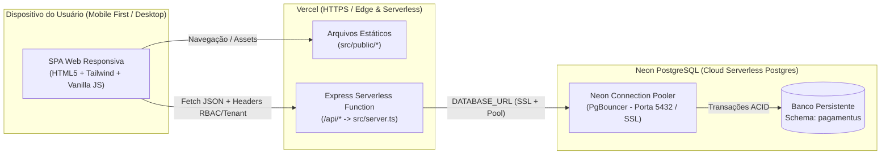

# 02 — Arquitetura e Persistência (Neon PostgreSQL + Express + SPA)

**Projeto:** Pagamentus — Módulo de Folha de Pagamento  
**Data:** 18/11/2026

---

## 1. Arquitetura Atual vs. Arquitetura Alvo Preservada

### 1.1. O que os alunos construíram (e será preservado)
Os alunos construíram uma arquitetura enxuta, rápida e de baixa complexidade operacional, documentada no `ADR-001-stack-e-ambientes.md` e na `SPEC-4.1`:
- **Backend:** Node.js + TypeScript + Express (`src/server.ts` e `src/app.ts`).
- **Camada de Dados:** Driver nativo `pg` (`node-postgres`) com suporte a transações explícitas (`BEGIN` / `COMMIT` / `ROLLBACK`), locks pessimistas (`SELECT ... FOR UPDATE`) e isolamento multi-inquilino por `organization_id` e schema `pagamentus`.
- **Frontend:** Single Page Application (SPA) em HTML5 semântico + Vanilla JS modular (`src/public/js/app.js`) + Tailwind CSS (`src/public/index.html` + `src/public/css/custom.css`), sem necessidade de bundlers pesados no cliente.

### 1.2. Diagrama da Arquitetura Alvo (Vercel + Neon PostgreSQL)



---

## 2. Unificação dos Pontos de Entrada (`src/server.ts` e `src/app.ts`)

Atualmente o repositório possui dois servidores Express separados:
1. `src/app.ts` (chamado por `src/index.ts`): monta os módulos em memória das SPECs 1.4–1.9 e 2.1–2.4.
2. `src/server.ts` (chamado por `server.js` e `Dockerfile`): monta os módulos PostgreSQL da Folha de Pagamento (SPECs 4.1 e 4.2) e serve a SPA `src/public`.

### Decisão Arquitetural (Menor Intervenção):
- **Preservar `src/server.ts` como o servidor principal da aplicação** e montar nele também as rotas de `src/app.ts` (ou importar os routers de `src/app.ts` sem conflito de prefixo), garantindo que tanto `npm start`, `npm run dev` quanto o entrypoint serverless da Vercel (`api/index.ts`) exponham **todas as rotas** (`/api/employees`, `/api/events`, `/api/time-records`, `/api/payroll`, `/api/esocial`, `/api/parameters`, `/api/companies` e as rotas dos Itens 1 e 2) além do frontend estático.
- **Remover os 8 arquivos `.js` duplicados de SQLite** em `src/db/`, `src/routes/` e `src/services/` para eliminar definitivamente a ambiguidade de resolução de módulos do Node.js/TypeScript.

---

## 3. Estratégia de Persistência no Neon PostgreSQL

### 3.1. Diagnóstico da Conexão Atual (`src/db/database.ts`)
No código atual (`src/db/database.ts`, linhas 10–19):
```ts
const poolConfig = process.env.DATABASE_URL
  ? { connectionString: isTest ? (process.env.DATABASE_URL_TEST || process.env.DATABASE_URL) : process.env.DATABASE_URL }
  : {
      host: process.env.PGHOST || '/tmp',
      port: parseInt(process.env.PGPORT || '5432', 10),
      database: targetDb,
      user: process.env.PGUSER || 'doug12',
    };
export const pool = new Pool(poolConfig);
```

### 3.2. Problemas Identificados para o Neon PostgreSQL
1. **SSL Obrigatório no Neon:** Conexões ao Neon (`*.neon.tech`) exigem TLS/SSL (`sslmode=require`). Sem configuração explícita de `ssl` quando a URL ou o ambiente exigir, o `pg.Pool` pode falhar ou rejeitar conexões dependendo da string de conexão.
2. **`search_path` por Conexão no Pool:** Atualmente, `SET search_path TO pagamentus, public` roda apenas uma vez dentro de `initDatabase()`. No Neon (especialmente usando o endpoint com Connection Pooler `-pooler`), conexões diferentes do pool não herdam o `search_path` de outra sessão.
3. **Dimensionamento do Pool para Serverless (Vercel):** Em funções serverless, um pool com o padrão de 10 conexões por instância pode esgotar conexões se não tiver `max`, `idleTimeoutMillis` e `connectionTimeoutMillis` ajustados.
4. **Inicialização Lazy (Sob Demanda) para Serverless:** Na Vercel, o servidor não é iniciado via `startServer()` com `app.listen()`, mas sim importando `app`. Se `initDatabase()` só for chamado dentro de `startServer()`, uma função serverless recém-iniciada nunca garantirá o schema inicializado se a migração não tiver rodado previamente.

### 3.3. Configuração Proposta do Pool para Neon (`src/db/database.ts`)
- Suportar `DATABASE_URL` (conexão pooled do Neon para a aplicação) e `DIRECT_URL` opcional (conexão direta do Neon para migrações DDL, se necessário).
- Configurar no `Pool`:
  - `options: '-c search_path=pagamentus,public'` (garante que toda conexão do pool já aponte para o schema `pagamentus` sem precisar de `SET search_path` manual a cada query).
  - `ssl`: habilitar automaticamente `{ rejectUnauthorized: false }` quando a string contiver `neon.tech` ou `sslmode=require` ou quando `PGSSLMODE=require`.
  - `max`: `5` em ambiente serverless (`process.env.VERCEL`), `10` em execução dedicada.
  - `idleTimeoutMillis: 30000`, `connectionTimeoutMillis: 10000`.
- Implementar um middleware/guarda leve `ensureDatabaseInitialized()` (com *promise singleton* por instância) ou comando explícito `npm run db:migrate` que aplica de forma idempotente o schema `pagamentus`, as tabelas de `SPEC-4.1`, as tabelas/constraints de `002_spec_4_2_rf053.sql` e a tabela de empresas (`companies`).

---

## 4. Segregação de Ambientes (Desenvolvimento, Teste e Produção)

Em conformidade com o `ADR-001` e `RF-079`:
1. **Produção / Homologação Vercel (`NODE_ENV=production`):**
   - Usa `DATABASE_URL` apontando para o banco/branch principal do projeto no Neon PostgreSQL.
   - Dados reais ou de homologação persistidos permanentemente; rotinas de limpeza de teste são bloqueadas se `NODE_ENV === 'production'`.
2. **Desenvolvimento (`NODE_ENV=development`):**
   - Usa `DATABASE_URL` apontando para a branch `dev` do Neon (ou instância local PostgreSQL se configurado pelo desenvolvedor).
   - Popula a carga inicial fictícia (3 colaboradores LGPD + empresa demonstração + parâmetros) **somente se a tabela estiver vazia** (`count(*) === 0`), nunca sobrescrevendo dados já cadastrados pelo usuário.
3. **Testes Automatizados (`NODE_ENV=test`):**
   - Usa `DATABASE_URL_TEST` (ou schema/tenant isolado com `organization_id` randômico, como já praticado em `tests/spec42-rf053.integration.test.ts` linha 39: `organizationId = 2000000000 + Math.floor(Math.random() * 100000000)`).
   - Nunca apaga registros do `organization_id = 1`.

---

## 5. Segurança e Proteção de Credenciais

- **Zero Credenciais no Frontend:** A SPA (`src/public/js/app.js`) conversa apenas com rotas relativas (`/api/...`). Nenhuma chave, token de banco ou string do Neon é enviada ao navegador.
- **Variáveis de Ambiente:** Todas as credenciais residem exclusivamente em `.env` (ignorado pelo `.gitignore`) localmente e nas *Environment Variables* criptografadas do painel da Vercel.
- **Consultas Parametrizadas:** 100% das queries em `src/routes/*.ts` e `src/services/*.ts` utilizam placeholders posicionais do PostgreSQL (`$1, $2, ...`), prevenindo SQL Injection.
- **RBAC e LGPD (`maskingService.ts`):** Mantido e aplicado em todas as rotas `/api/*`, garantindo que o perfil `consulta_assistente` receba valores monetários e CPFs mascarados diretamente do servidor.
