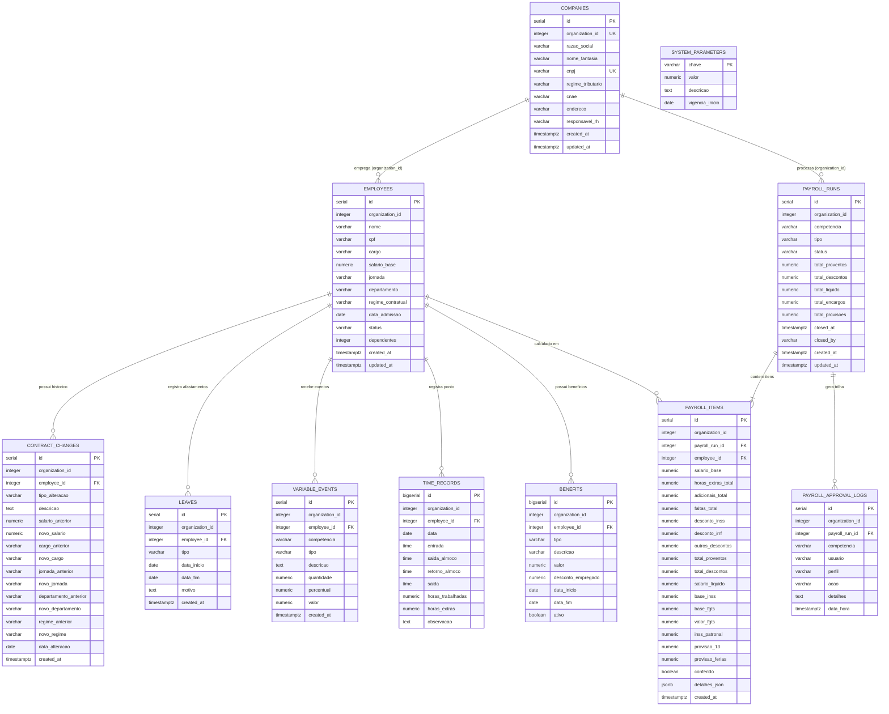

# 03 — Modelo de Dados no Neon PostgreSQL

**Projeto:** Pagamentus — Módulo de Folha de Pagamento  
**Schema Principal:** `pagamentus`  
**Isolamento Multi-Inquilino:** Coluna `organization_id INTEGER NOT NULL DEFAULT 1` em todas as tabelas operacionais.

---

## 1. Diagrama Entidade-Relacionamento (DER — Folha de Pagamento)

---

## 2. Inventário das Tabelas Existentes e Complementos Necessários

### 2.1. Tabelas Existentes (100% Preservadas)
1. **`pagamentus.system_parameters`** (`src/db/database.ts`):
   - Armazena `aliquota_fgts`, `aliquota_inss_patronal`, `aliquota_rat`, `aliquota_terceiros`, `deducao_dependente_irrf`, `teto_inss`, `salario_minimo` com tipo `NUMERIC(12, 4)`.
2. **`pagamentus.employees`** (`src/db/database.ts` + `002_spec_4_2_rf053.sql`):
   - Armazena os colaboradores e vínculos contratuais, com `salario_base NUMERIC(12, 2)`, `UNIQUE (organization_id, cpf)` e `UNIQUE (organization_id, id)` (para suportar FKs compostas tenant-aware).
3. **`pagamentus.contract_changes`** (`src/db/database.ts` + `002_spec_4_2_rf053.sql`):
   - Histórico imutável de admissão, reajustes salariais, promoções, mudanças de jornada, departamento e regime contratual.
4. **`pagamentus.leaves`** (`src/db/database.ts` + `002_spec_4_2_rf053.sql`):
   - Registro de afastamentos e licenças, com validação de intervalo de datas (`ck_leaves_date_range`) e bloqueio transacional de sobreposição via `daterange`.
5. **`pagamentus.variable_events`** (`src/db/database.ts` + `002_spec_4_2_rf053.sql`):
   - Eventos mensais por competência (`YYYY-MM`): `hora_extra`, `falta`, `adicional`, `desconto`, com precisão `NUMERIC(12, 2)`.
6. **`pagamentus.time_records`** (`002_spec_4_2_rf053.sql`):
   - Marcações de ponto importadas ou lançadas, com `UNIQUE (organization_id, employee_id, data)` e checagem de ordem cronológica das batidas.
7. **`pagamentus.benefits`** (`002_spec_4_2_rf053.sql`):
   - Benefícios vinculados ao colaborador (`vale_transporte`, `vale_refeicao`, `vale_alimentacao`, `plano_saude`) com `valor NUMERIC(12, 2)` e `desconto_empregado NUMERIC(12, 2)`.
8. **`pagamentus.payroll_runs`** (`src/db/database.ts`):
   - Cabeçalho do processamento da folha por competência e tipo (`UNIQUE (organization_id, competencia, tipo)`), status (`rascunho`, `em_revisao`, `aprovada`, `fechada`) e totalizadores `NUMERIC(14, 2)`.
9. **`pagamentus.payroll_items`** (`src/db/database.ts`):
   - Resultado individual calculado por empregado na folha (`UNIQUE (organization_id, payroll_run_id, employee_id)`), todos os valores em `NUMERIC(12, 2)` e a memória de cálculo completa em `detalhes_json JSONB`.
10. **`pagamentus.payroll_approval_logs`** (`src/db/database.ts`):
    - Trilha de auditoria imutável de todas as ações (cadastros, alterações, cálculos, aprovações, fechamentos e reaberturas).

### 2.2. Complementos Mínimos no Modelo de Dados (Aditivos e Não-Destrutivos)
Para atender 100% da jornada funcional ponta a ponta (Seção 8 do Prompt Mestre) sem quebrar nenhum teste existente:

1. **Nova tabela `pagamentus.companies` (Cadastro da Empresa Empregadora):**
   - Permite que o usuário cadastre/edite os dados da empresa pelo celular (Razão Social, Nome Fantasia, CNPJ fictício, Regime Tributário, Endereço, Responsável) e que o Holerite e o eSocial leiam esses dados reais do banco Neon (com seed inicial da `"Audicon Contabilidade & Gestão Empresarial Ltda"` para preservar compatibilidade total com os testes existentes).
2. **Colunas aditivas opcionais em `payroll_runs` e `payroll_items`:**
   - Em `payroll_runs`: `closed_at TIMESTAMPTZ`, `closed_by VARCHAR(150)` para registrar o momento exato e responsável pelo fechamento.
   - Em `payroll_items`: `conferido BOOLEAN NOT NULL DEFAULT FALSE` para permitir que o usuário marque cada funcionário como "Conferido" pelo celular durante a etapa de conferência antes de fechar a folha!

---

## 3. Integridade Monetária, Transacional e de Fechamento

| Requisito de Integridade | Como é Garantido no Modelo Neon PostgreSQL |
|---|---|
| **Precisão Monetária Decimal** | Todas as colunas financeiras usam `NUMERIC(12, 2)` ou `NUMERIC(14, 2)` (e `NUMERIC(12, 4)` para alíquotas). Nenhum tipo `REAL`/`FLOAT` é usado no PostgreSQL. |
| **Chaves Estrangeiras Tenant-Aware** | As tabelas filhas possuem FKs compostas `FOREIGN KEY (organization_id, employee_id) REFERENCES employees (organization_id, id) ON DELETE CASCADE`, impedindo vazamento ou vínculo cruzado entre organizações diretamente no SGBD (erro PostgreSQL `23503`). |
| **Restrições de Unicidade** | `uq_emp_org_cpf (organization_id, cpf)`, `uq_run_org_comp_tipo (organization_id, competencia, tipo)`, `uq_item_org_run_emp (organization_id, payroll_run_id, employee_id)`, `uq_time_records_org_employee_date (organization_id, employee_id, data)`. |
| **Transações e Concorrência** | O cálculo e gravação da folha (`calculateMonthlyPayroll`), o registro de alterações contratuais, o lançamento de licenças e a importação de ponto executam dentro de `BEGIN ... COMMIT/ROLLBACK` com `SELECT ... FOR UPDATE` no empregado/folha para evitar *race conditions*. |
| **Imutabilidade de Folha Fechada** | Quando `payroll_runs.status = 'fechada'`, o backend bloqueará (HTTP 409) qualquer tentativa de: (a) recalcular/sobrescrever a folha daquela competência; (b) inserir/editar/excluir `variable_events` daquela competência; (c) alterar status sem passar pelo endpoint explícito de **Reabertura Controlada** com justificativa obrigatória e log em `payroll_approval_logs`. |
