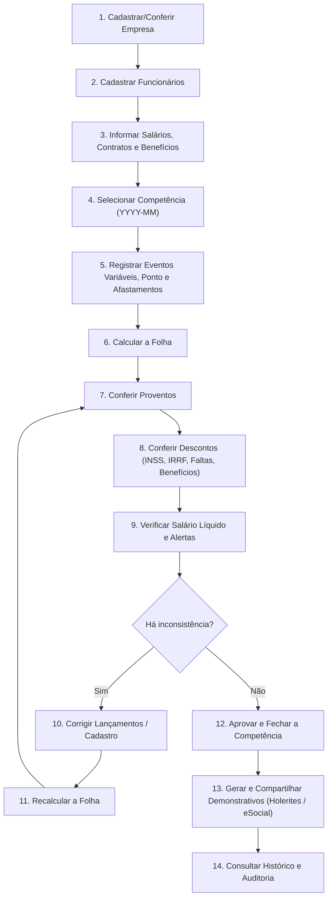

# 04 — Fluxo Funcional Ponta a Ponta da Folha de Pagamento

**Projeto:** Pagamentus — Módulo de Folha de Pagamento  
**Data:** 18/11/2026

---

## 1. Visão Geral da Jornada de 14 Etapas

O sistema deve permitir que uma pessoa comum realize todo o ciclo mensal da folha de pagamento pelo celular ou computador, seguindo uma sequência lógica e assistida de 14 etapas:

---

## 2. Análise Detalhada das 14 Etapas (Existente vs. Faltante vs. Mobile vs. Neon)

### Etapa 1 — Cadastrar a Empresa
- **O que já existe:** Dados fixos da empresa (`"Audicon Contabilidade & Gestão Empresarial Ltda"`, CNPJ `00.123.456/0001-78`) embutidos em `payrollRoutes.ts`, `payrollService.ts`, `esocialService.ts` e `index.html`. No Item 1 (`SPEC-1.6`), há `PessoaEmpresaService.ts` (em memória).
- **O que está incompleto/ausente:** Tabela persistente `companies` no schema `pagamentus`, endpoints `GET /api/company` e `PUT /api/company`, e modal/tela simples para visualizar/editar os dados da empresa empregadora.
- **Como será armazenado no Neon:** Tabela `pagamentus.companies` vinculada a `organization_id`, já pré-populada com a empresa padrão para não quebrar testes existentes.
- **Como funcionará no celular:** Cartão de identificação da empresa no topo do Dashboard com botão "Editar Empresa" abrindo formulário curto (Razão Social, CNPJ, Regime, Endereço, Responsável).
- **Critério de conclusão:** Alterar o nome/CNPJ da empresa pelo celular persiste no Neon e reflete imediatamente no cabeçalho do Holerite e no evento S-1000 do eSocial.

### Etapa 2 — Cadastrar os Funcionários
- **O que já existe:** `GET /api/employees`, `POST /api/employees`, `PUT /api/employees/:id`, `DELETE /api/employees/:id` (`src/routes/employeeRoutes.ts`) e modal `#modal-employee` (`src/public/index.html`).
- **O que está incompleto/ausente:** Campos `departamento` e `regime_contratual` (criados na migration `002_spec_4_2_rf053.sql`) não estão no formulário `#form-employee`; falta máscara automática de CPF e validação inline amigável no mobile.
- **Como será armazenado no Neon:** Tabela `pagamentus.employees` e registro automático do `"Contrato Inicial"` em `pagamentus.contract_changes`.
- **Como funcionará no celular:** Botão de ação rápida ("+ Novo Funcionário") com formulário vertical em etapas/grupos claros, teclado numérico para CPF (`inputmode="numeric"`), salário (`inputmode="decimal"`) e dependentes, e lista de funcionários exibida em **cartões mobile** (sem precisar rolar 9 colunas horizontalmente).
- **Critério de conclusão:** Cadastrar 3 novos funcionários pelo celular com validação de CPF único e visualização imediata em cartões.

### Etapa 3 — Informar Salários, Dados Contratuais e Benefícios
- **O que já existe:** `PUT /api/employees/:id`, `POST /api/employees/:id/contract-changes` e `GET/POST /api/employees/:id/benefits` (`src/routes/employeeRoutes.ts`).
- **O que está incompleto/ausente:** Não há interface na SPA para lançar/consultar Benefícios (Vale-Transporte, Vale-Refeição, Plano de Saúde) nem para abrir o formulário específico de Alteração Contratual com motivo/vigência.
- **Como será armazenado no Neon:** Tabelas `pagamentus.employees`, `pagamentus.contract_changes` e `pagamentus.benefits`.
- **Como funcionará no celular:** No cartão do funcionário, botão "Contrato & Benefícios" que abre gaveta/modal para adicionar benefício ou registrar reajuste salarial/mudança de cargo com histórico visível.
- **Critério de conclusão:** Registrar um benefício com desconto para o empregado e um reajuste salarial pelo celular e vê-los refletidos no histórico e no cálculo da folha.

### Etapa 4 — Selecionar a Competência
- **O que já existe:** Inputs `<input type="month">` sincronizados (`events-competencia`, `payroll-competencia`, `receipt-competencia`, `esocial-competencia`) em `src/public/js/app.js` (`syncCompetenceInputs`).
- **O que está incompleto/ausente:** O seletor de competência fica escondido dentro de abas específicas; no celular o usuário não vê globalmente em qual mês está trabalhando nem se aquele mês está `Rascunho`, `Aprovada` ou `Fechada`.
- **Como será armazenado no Neon:** Coluna `competencia VARCHAR(7)` (`YYYY-MM`) em `payroll_runs` e `variable_events`.
- **Como funcionará no celular:** Barra contextual persistente no topo (abaixo do header) mostrando a **Competência Ativa** (ex: `Nov/2026` com seletor rápido) e o **Badge de Status** (`Rascunho` / `Aprovada` / `Fechada`).
- **Critério de conclusão:** Trocar a competência na barra global atualiza todas as telas e informa imediatamente o status daquela folha.

### Etapa 5 — Registrar Eventos (Horas Extras, Faltas, Adicionais, Ponto e Afastamentos)
- **O que já existe:** `GET/POST/DELETE /api/events`, `POST /api/employees/:id/leaves`, `GET/POST /api/time-records` e modais `#modal-event` e `#modal-leave`.
- **O que está incompleto/ausente:** (1) Falta bloqueio de lançamento quando a competência está `fechada`; (2) Falta possibilidade de editar um evento variável ou excluir/encerrar afastamento; (3) Falta interface para importar/lançar registro de ponto (`time_records`); (4) No celular, a lista de eventos é uma tabela de 7 colunas.
- **Como será armazenado no Neon:** Tabelas `pagamentus.variable_events`, `pagamentus.leaves` e `pagamentus.time_records`.
- **Como funcionará no celular:** Cartões de eventos agrupáveis por funcionário, prévia instantânea do valor calculado no modal (ex: ao digitar 5 horas extras a 50%, já exibe o valor estimado em R$ antes mesmo de salvar) e botões de toque confortáveis (≥ 44×44 px) para editar ou excluir.
- **Critério de conclusão:** Lançar hora extra, falta eicional pelo celular e visualizar o valor calculado automaticamente.

### Etapa 6 — Calcular a Folha
- **O que já existe:** `POST /api/payroll/calculate` e `GET /api/payroll/preview/:competencia` (`src/routes/payrollRoutes.ts` e `src/services/payrollService.ts`).
- **O que está incompleto/ausente:** (1) O motor ainda não incorpora descontos de `benefits` ativos no cálculo mensal; (2) Falta estado de carregamento (*loading spinner* e desabilitação de botão contra duplo toque) durante o processamento; (3) Falta impedir recálculo de folha já `fechada`.
- **Como será armazenado no Neon:** Transação atômica gravando `pagamentus.payroll_runs`, `pagamentus.payroll_items` e `pagamentus.payroll_approval_logs`.
- **Como funcionará no celular:** Botão destacado de largura total no mobile ("⚡ Calcular Folha da Competência") com feedback visual de processamento e resumo imediato.
- **Critério de conclusão:** Acionar o cálculo pelo celular, persistir no Neon e exibir os totalizadores atualizados sem duplicidade por duplo toque.

### Etapas 7, 8 e 9 — Conferir Proventos, Descontos, Salário Líquido e Alertas
- **O que já existe:** Tabela `#payroll-items-table-body` com 9 colunas e cards totalizadores (`#tot-proventos`, `#tot-descontos`, `#tot-liquido`, `#tot-encargos`, `#tot-provisoes`).
- **O que está incompleto/ausente:** No celular, uma tabela de 9 colunas exige rolagem horizontal severa, dificultando comparar o nome do funcionário (coluna 1) com o salário líquido (coluna 7) e o botão de recibo (coluna 9). Também não há botão de "Marcar como Conferido" por funcionário nem alertas visuais (ex: funcionário afastado, desconto elevado, falta lançada).
- **Como será armazenado no Neon:** `payroll_items.detalhes_json` + coluna booleana `payroll_items.conferido`.
- **Como funcionará no celular:** Em telas `< 768px`, cada funcionário calculado é exibido em um **Cartão de Conferência Mobile** contendo:
  - Nome, Cargo e Status de Conferência (Pendente / Conferido);
  - Bloco claro: **Bruto (Proventos)** | **Descontos (-)** | **Salário Líquido (Destaque Verde)**;
  - Acordeão/Expansão ("Ver memória de cálculo") mostrando Salário Base, Horas Extras, Adicionais, Faltas, Benefícios, INSS faixa a faixa, IRRF e FGTS;
  - Botões rápidos: "✓ Conferido", "Corrigir Evento" e "Holerite".
- **Critério de conclusão:** Usuário no smartphone (320px a 430px) lê proventos, descontos e líquido de todos os colaboradores sem nenhuma rolagem horizontal.

### Etapas 10 e 11 — Corrigir Inconsistências e Recalcular
- **O que já existe:** Exclusão/inclusão de eventos na aba Eventos e novo clique em Calcular na aba Folha.
- **O que está incompleto/ausente:** No celular, se o usuário vê um erro no cartão de cálculo do funcionário, ele precisa trocar de aba manualmente, procurar o evento do funcionário, excluir, criar outro, voltar para a aba de folha e recalcular.
- **Como será armazenado no Neon:** Atualização em `variable_events` e atualização transacional em `payroll_runs` / `payroll_items`.
- **Como funcionará no celular:** Ação direta "Ajustar Lançamentos" no próprio cartão de cálculo do funcionário (enquanto a folha estiver aberta), permitindo excluir/corrigir um evento ou lançar novo evento e **recalcular automaticamente** com 1 toque.
- **Critério de conclusão:** Identificar um lançamento errado no celular, corrigi-lo e recalcular a folha em menos de 3 toques.

### Etapa 12 — Fechar a Competência
- **O que já existe:** `POST /api/payroll/approve` (`status: 'aprovada'` ou `'fechada'`) e botões `#btn-approve-payroll` e `#btn-close-payroll`.
- **O que está incompleto/ausente:**
  1. Usa `window.prompt()` nativo do navegador (`src/public/js/app.js` linha 675), que é ruim no celular e não mostra o resumo do que está sendo fechado.
  2. Não bloqueia edições posteriores após o status `'fechada'`.
  3. Não possui opção de **Reabertura Controlada** com justificativa obrigatória para retificação (conforme `RB-002` e Seção 5.5).
- **Como será armazenado no Neon:** `payroll_runs.status = 'fechada'`, `closed_at`, `closed_by` e registro imutável em `payroll_approval_logs`.
- **Como funcionará no celular:** Modal dedicado de **Confirmação de Fechamento** exibindo: Competência, Total de Funcionários, Total Bruto, Total Descontos, **Total Líquido a Pagar**, Total de Encargos, aviso claro de que a competência ficará travada contra edições acidentais, campo de observação/justificativa e botão de confirmação protegido contra toque acidental.
- **Critério de conclusão:** Fechar a competência pelo celular grava o status `fechada` no Neon, desabilita edições de eventos/recálculo daquela competência e registra a auditoria.

### Etapa 13 — Gerar e Consultar Demonstrativos (Holerites e Resumos)
- **O que já existe:** `GET /api/payroll/receipt/:competencia/:employeeId`, aba `#tab-receipts` com `#printable-holerite`, `window.print()` e exportação eSocial (`GET /api/esocial/download/:competencia`).
- **O que está incompleto/ausente:** No smartphone (320px–390px), `#printable-holerite` usa cabeçalho horizontal e tabela de 5 colunas que ficam espremidos; falta um modo de leitura responsiva vertical para celular ao lado do layout formal de impressão/PDF e botão de compartilhamento (`navigator.share` / exportação limpa). Também é preciso corrigir o cálculo do resumo de provisões no rodapé (`0.43`/`0.57` hardcoded em `app.js` linhas 834-835).
- **Como será armazenado no Neon:** Lido diretamente de `payroll_runs` e `payroll_items.detalhes_json` persistidos no Neon.
- **Como funcionará no celular:** Seletor rápido de colaborador (com botões Anterior/Próximo para folhear holerites no celular), visualização responsiva em blocos claros no mobile, botão "🖨️ Salvar PDF / Imprimir" (com `@media print` preservado) e botão "📤 Compartilhar Resumo" via Web Share API quando disponível no smartphone.
- **Critério de conclusão:** Abrir, ler confortavelmente sem zoom e imprimir/salvar em PDF os demonstrativos dos colaboradores pelo celular.

### Etapa 14 — Consultar o Histórico
- **O que já existe:** `GET /api/payroll/audit-logs`, `GET /api/events/contract-changes` e `GET /api/payroll/preview/:competencia`.
- **O que está incompleto/ausente:** Não há endpoint `GET /api/payroll/runs` nem lista visual de **Competências Anteriores Processadas/Fechadas** para que o usuário veja todas as folhas já fechadas no Neon e toque em uma para reabrir ou consultar seus holerites.
- **Como será armazenado no Neon:** Consulta direta a `pagamentus.payroll_runs` e `pagamentus.payroll_approval_logs`.
- **Como funcionará no celular:** Lista de Competências Históricas (cards com Mês/Ano, Status, Total Líquido, Data de Fechamento e botão "Consultar Folha" / "Holerites") + Trilha de Auditoria em cartões cronológicos legíveis no celular.
- **Critério de conclusão:** Após encerrar a sessão e abrir novamente a aplicação no celular, consultar a lista de folhas fechadas e abrir uma folha histórica persistida no Neon.
