# 07 — Plano Mestre de Implementação por Microetapas

**Projeto:** Pagamentus — Módulo de Folha de Pagamento  
**Diretriz:** Plano incremental dividido em **7 Macrofases (Fases A a G)** e **14 Microetapas (ME-01 a ME-14)**, preservando o trabalho existente dos alunos e priorizando **Neon PostgreSQL**, **Mobile First** e **Vercel**.

---

## Visão Geral do Encadeamento das Fases e Microetapas

```mermaid
flowchart TD
    subgraph FASE_A["FASE A — Diagnóstico e Estabilização"]
        ME01["ME-01: Limpeza dos .js SQLite legados e unificação do entrypoint Express"]
    end
    subgraph FASE_B["FASE B — Persistência Neon PostgreSQL"]
        ME02["ME-02: Adaptação do Pool para Neon (SSL + search_path) e unificação das migrações"]
        ME03["ME-03: Persistência da Empresa Empregadora (tabela companies + API)"]
    end
    subgraph FASE_C["FASE C — Integração Funcional e Fechamento Seguro"]
        ME04["ME-04: Imutabilidade de Folha Fechada, Reabertura Controlada e Histórico de Competências"]
        ME05["ME-05: Integração de Benefícios, Ponto e Conferência Individual no Motor de Folha"]
    end
    subgraph FASE_D["FASE D — Motor de Folha, Cálculos e Precisão"]
        ME06["ME-06: Provisões exatas, alertas de conferência, empresa dinâmica no Holerite/eSocial e sessão"]
    end
    subgraph FASE_E["FASE E — UX/UI Mobile First"]
        ME07["ME-07: Estrutura Mobile First (Bottom Nav, Barra de Competência Global e Stepper da Jornada)"]
        ME08["ME-08: Cartões Mobile para Empregados, Contratos, Benefícios e Formulários Touch"]
        ME09["ME-09: Cartões Mobile para Eventos Variáveis, Afastamentos e Ponto com Prévia Automática"]
        ME10["ME-10: Cartões de Conferência de Cálculos, Modal de Fechamento Seguro e Reabertura no Celular"]
        ME11["ME-11: Holerite Responsivo Mobile, Navegação Rápida entre Recibos, Histórico e Acessibilidade WCAG AA"]
    end
    subgraph FASE_F["FASE F — Hospedagem Vercel"]
        ME12["ME-12: Configuração Serverless Vercel (api/index.ts, vercel.json) e resiliência de rede"]
    end
    subgraph FASE_G["FASE G — Integração e Validação Final"]
        ME13["ME-13: Suíte de Testes de Banco Neon (DB-01 a DB-15) e Testes de API/Cálculo"]
        ME14["ME-14: Suíte de Testes Mobile (MOB-01 a MOB-18) e Teste Integrado Ponta a Ponta pelo Celular"]
    end

    ME01 --> ME02 --> ME03 --> ME04 --> ME05 --> ME06 --> ME07 --> ME08 --> ME09 --> ME10 --> ME11 --> ME12 --> ME13 --> ME14
```

---

## Contratos Detalhados das 14 Microetapas

### FASE A — Diagnóstico e Estabilização

#### ME-01 — Remoção dos artefatos `.js` legados de SQLite e unificação do servidor Express
1. **ID:** `ME-01`
2. **Título:** Limpeza dos módulos `.js` de SQLite e unificação do entrypoint em `src/server.ts`
3. **Objetivo:** Eliminar a colisão de módulos `.js` vs `.ts` (que forçava `jest.mock` nos testes) e garantir que `npm run dev`, `npm start` e `npm run build` iniciem o servidor completo com todas as rotas da Folha de Pagamento e da Plataforma.
4. **Problema observado:** Existem 8 arquivos `.js` legados baseados em `better-sqlite3` dentro de `src/db`, `src/routes` e `src/services` que sombreiam os arquivos `.ts` de PostgreSQL; além disso, `package.json` aponta para `src/index.ts` (que não inclui as rotas de folha nem o frontend `src/public`).
5. **Evidência:** `src/db/database.js`, `src/routes/employeeRoutes.js`, `src/routes/eventRoutes.js`, `src/routes/parameterRoutes.js`, `src/routes/payrollRoutes.js`, `src/routes/esocialRoutes.js`, `src/services/payrollService.js`, `src/services/esocialService.js`, `src/services/maskingService.js`; `tests/spec42-rf053.integration.test.ts` L1-5; `package.json` L5-9.
6. **Componentes existentes reaproveitados:** `src/server.ts`, `src/app.ts`, todos os módulos `.ts` de `src/routes/` e `src/services/`.
7. **Arquivos envolvidos:** Remoção dos 9 arquivos `.js` legados dentro de `src/` (1 em `src/db/`, 5 em `src/routes/`, 3 em `src/services/`); ajuste em `src/server.ts`, `src/index.ts`, `package.json` e `test/test_endpoints.ts` (substituindo socket Unix `/tmp/express_test.sock` por porta efêmera HTTP para funcionar em Windows e Linux).
8. **Alterações propostas:** Remover os arquivos `.js` duplicados em `src/`, montar os routers de `src/app.ts` também em `src/server.ts` (ou exportar o app unificado) e atualizar `package.json` para que o build e start usem o servidor unificado.
9. **Dependências:** Nenhuma (primeira microetapa).
10. **Impacto no banco:** Garante que 100% das importações apontem para `src/db/database.ts` (PostgreSQL/Neon) e nunca para SQLite.
11. **Impacto no mobile:** Permite que o servidor sirva a SPA `src/public` diretamente via `npm run dev` e `npm start`.
12. **Impacto na hospedagem:** Prepara um único `app` Express exportável para a Vercel.
13. **Critérios de aceite:** `npm run build` compila sem erros; `tests/spec42-rf053.integration.test.ts` funciona sem precisar de `jest.mock`; `GET /api/health` e `GET /` funcionam no servidor principal.
14. **Testes:** `npm run build` e execução das suítes unitárias existentes.
15. **Riscos:** Algum teste antigo referenciar `.js` explicitamente (verificado: nenhum teste referencia `.js`).
16. **Estratégia de reversão:** `git checkout` / restauração dos arquivos caso necessário.
17. **Evidências de conclusão:** Saída limpa do `tsc` (`npm run build`) e listagem de `src/` contendo apenas `.ts` e `src/public/*`.

---

### FASE B — Persistência Neon PostgreSQL

#### ME-02 — Configuração do Pool para Neon PostgreSQL e Migração Automática Unificada
1. **ID:** `ME-02`
2. **Título:** Adaptação de `src/db/database.ts` para Neon PostgreSQL (SSL, `search_path`, Pool Serverless) e incorporação de `002_spec_4_2_rf053.sql`
3. **Objetivo:** Garantir que toda conexão aberta no Neon PostgreSQL utilize SSL seguro e `search_path=pagamentus,public`, e que `initDatabase()` crie todas as tabelas, constraints e índices de `SPEC-4.1` e `SPEC-4.2` de forma atômica e idempotente.
4. **Problema observado:** `src/db/database.ts` não configura `options: '-c search_path=pagamentus,public'` nem `ssl` no `Pool`, e não executa a migration `002_spec_4_2_rf053.sql` (`time_records`, `benefits`, colunas `departamento` e `regime_contratual`).
5. **Evidência:** `src/db/database.ts` L10-35; `src/db/migrations/002_spec_4_2_rf053.sql` L1-212.
6. **Componentes existentes reaproveitados:** `src/db/database.ts` e `src/db/migrations/002_spec_4_2_rf053.sql`.
7. **Arquivos envolvidos:** `src/db/database.ts`, `.env.example`.
8. **Alterações propostas:**
   - Configurar `Pool` em `src/db/database.ts` com suporte a `DATABASE_URL` do Neon, detecção automática de SSL (`sslmode=require` / `neon.tech`), `options: '-c search_path=pagamentus,public'`, `max` adequado para serverless e helper `ensureDatabaseInitialized()`.
   - Incluir no `initDatabase()` a criação/alteração idempotente das colunas `departamento`, `regime_contratual`, tabelas `time_records` e `benefits`, constraints e índices da `002_spec_4_2_rf053.sql`.
9. **Dependências:** `ME-01`.
10. **Impacto no banco:** Todas as tabelas de folha passam a existir automaticamente no schema `pagamentus` do Neon PostgreSQL.
11. **Impacto no mobile:** Elimina erros 500 ao consultar/cadastrar benefícios, ponto e departamentos pelo celular.
12. **Impacto na hospedagem:** Compatibiliza o `pg.Pool` com o Connection Pooler do Neon e as funções serverless da Vercel.
13. **Critérios de aceite:** Conexão ao Neon estabelecida com sucesso (`DB-01`); todas as tabelas criadas no schema `pagamentus`; queries de `time_records` e `benefits` funcionam imediatamente após `initDatabase()`.
14. **Testes:** `tests/spec42-rf053.integration.test.ts` e teste de conexão/schema no Neon.
15. **Riscos:** Timeout em cold start do Neon (mitigado com `connectionTimeoutMillis: 15000`).
16. **Estratégia de reversão:** Reverter configuração do `poolConfig` em `src/db/database.ts`.
17. **Evidências de conclusão:** Log de `initDatabase()` no Neon e consulta `information_schema.tables` listando todas as tabelas em `pagamentus`.

#### ME-03 — Persistência da Empresa Empregadora no Neon (`companies`)
1. **ID:** `ME-03`
2. **Título:** Criação da tabela `companies`, seed inicial compatível e rotas `GET/PUT /api/company`
3. **Objetivo:** Permitir cadastrar, consultar e atualizar os dados da empresa empregadora no Neon PostgreSQL, substituindo os dados fixos (hardcoded) nos recibos e exportações.
4. **Problema observado:** A razão social, CNPJ e endereço da empresa estão fixos no código (`payrollRoutes.ts` L177, `payrollService.ts` L250, `esocialService.ts` L19, `index.html` L455).
5. **Evidência:** `src/routes/payrollRoutes.ts` L177-181; `src/services/esocialService.ts` L19-23.
6. **Componentes existentes reaproveitados:** Padrão de rotas Express e `maskingService.ts` (`req.organizationId`, `req.isRhAdmin`).
7. **Arquivos envolvidos:** `src/db/database.ts`, `src/types/index.ts`, `src/routes/companyRoutes.ts` (novo router enxuto), `src/server.ts`.
8. **Alterações propostas:**
   - Criar tabela `pagamentus.companies` (`id`, `organization_id UNIQUE`, `razao_social`, `nome_fantasia`, `cnpj`, `regime_tributario`, `cnae`, `endereco`, `responsavel_rh`, `updated_at`) em `initDatabase()`.
   - Criar seed padrão para `organization_id = 1` com `"Audicon Contabilidade & Gestão Empresarial Ltda"`, CNPJ `"00.123.456/0001-78"`, endereço `"Av. Agamenon Magalhães, 1200 - Recife/PE"` (mantendo 100% de compatibilidade com os testes existentes).
   - Criar `GET /api/company` e `PUT /api/company` (restrito a `rh_admin` com log em `payroll_approval_logs`).
9. **Dependências:** `ME-02`.
10. **Impacto no banco:** Nova tabela `pagamentus.companies` persistida no Neon.
11. **Impacto no mobile:** Permite cumprir a Etapa 1 da jornada ("Cadastrar/editar a empresa") pelo celular.
12. **Impacto na hospedagem:** Stateless, 100% compatível com Vercel.
13. **Critérios de aceite:** `GET /api/company` retorna os dados da empresa; `PUT /api/company` atualiza no Neon e grava trilha de auditoria.
14. **Testes:** Teste de integração de leitura e atualização da empresa por tenant (`organization_id`).
15. **Riscos:** Nenhum risco para testes legados graças ao seed padrão idêntico.
16. **Estratégia de reversão:** Fallback automático para os dados padrão caso a linha não exista.
17. **Evidências de conclusão:** Resposta JSON de `GET /api/company` e `PUT /api/company` persistida no Neon.

---

### FASE C — Integração Funcional e Fechamento Seguro

#### ME-04 — Imutabilidade de Folha Fechada, Reabertura Controlada e Histórico de Competências
1. **ID:** `ME-04`
2. **Título:** Proteção de competência fechada (`RB-002`), endpoint de reabertura controlada e listagem histórica de folhas (`GET /api/payroll/runs`)
3. **Objetivo:** Garantir que uma folha com `status = 'fechada'` não possa ser sobrescrita nem ter eventos variáveis adicionados/removidos acidentalmente, permitir reabertura formal auditada e listar todas as competências processadas.
4. **Problema observado:** `calculateMonthlyPayroll` sobrescreve folhas fechadas; `POST/DELETE /api/events` permite alterar eventos de competência fechada; não há rota que liste o histórico de `payroll_runs`.
5. **Evidência:** `src/services/payrollService.ts` L318-334; `src/routes/eventRoutes.ts` L42-152; `src/routes/payrollRoutes.ts`.
6. **Componentes existentes reaproveitados:** `src/services/payrollService.ts`, `src/routes/payrollRoutes.ts`, `src/routes/eventRoutes.ts`.
7. **Arquivos envolvidos:** `src/db/database.ts`, `src/services/payrollService.ts`, `src/routes/payrollRoutes.ts`, `src/routes/eventRoutes.ts`.
8. **Alterações propostas:**
   - Adicionar colunas `closed_at TIMESTAMPTZ` e `closed_by VARCHAR(150)` em `payroll_runs` e `conferido BOOLEAN DEFAULT FALSE` em `payroll_items`.
   - Em `calculateMonthlyPayroll(..., saveToDatabase=true)` e em `POST/PUT/DELETE /api/events`, verificar se existe `payroll_runs` com `status = 'fechada'` para aquela `(organization_id, competencia)`. Se existir, retornar erro claro HTTP 409 (`"A competência YYYY-MM está fechada e protegida contra alterações. Realize a reabertura controlada se precisar retificar."`).
   - Criar `POST /api/payroll/reopen` (exige `rh_admin` e `justificativa` não vazia), que muda o status de `fechada` para `em_revisao` e grava log em `payroll_approval_logs`.
   - Criar `GET /api/payroll/runs` para listar todas as folhas processadas no Neon (`ORDER BY competencia DESC`) e `PATCH /api/payroll/items/:id/check` para alternar o status `conferido` de cada empregado na folha.
9. **Dependências:** `ME-02`.
10. **Impacto no banco:** Colunas aditivas em `payroll_runs` e `payroll_items` com `ADD COLUMN IF NOT EXISTS`.
11. **Impacto no mobile:** Viabiliza o checklist de conferência por colaborador, o bloqueio seguro após o fechamento e a tela de Histórico de Competências no celular.
12. **Impacto na hospedagem:** Nenhum impacto negativo.
13. **Critérios de aceite:** Tentar lançar evento ou recalcular competência `fechada` retorna HTTP 409; reabrir com justificativa retorna HTTP 200 e permite recalcular; `GET /api/payroll/runs` lista o histórico persistido.
14. **Testes:** Testes automatizados de bloqueio de folha fechada, reabertura e listagem histórica (`DB-12`, `DB-13`).
15. **Riscos:** Testes antigos que fecham a folha e depois recalculam a mesma competência (verificado em `test/test_endpoints.ts`: a aprovação/fechamento é o último passo, linha 161, portanto não quebra nenhum teste existente).
16. **Estratégia de reversão:** Reverter verificação de status caso necessário.
17. **Evidências de conclusão:** Testes de integração comprovando HTTP 409 em folha fechada e HTTP 200 após reabertura auditada.

#### ME-05 — Integração de Benefícios, Ponto e Edição de Eventos no Motor de Folha
1. **ID:** `ME-05`
2. **Título:** Integração de descontos de benefícios ativos e horas extras de ponto ao cálculo da folha e edição de eventos variáveis
3. **Objetivo:** Conectar os recursos já criados na `SPEC-4.2` (`benefits` e `time_records`) ao motor de cálculo mensal (`payrollService.ts`) e permitir editar um evento variável (`PUT /api/events/:id`).
4. **Problema observado:** Benefícios cadastrados em `benefits` não são lidos durante `calculateMonthlyPayroll`; eventos variáveis só possuem `POST` e `DELETE`, sem `PUT` para correção rápida no celular.
5. **Evidência:** `src/services/payrollService.ts` L159-239; `src/routes/eventRoutes.ts`.
6. **Componentes existentes reaproveitados:** `src/services/payrollService.ts`, `src/routes/eventRoutes.ts`, `src/routes/employeeRoutes.ts`, `src/routes/timeRecordRoutes.ts`.
7. **Arquivos envolvidos:** `src/services/payrollService.ts`, `src/routes/eventRoutes.ts`, `src/routes/employeeRoutes.ts`.
8. **Alterações propostas:**
   - Em `calculateMonthlyPayroll`: consultar `benefits` ativos do empregado vigentes na competência (`ativo = true AND data_inicio <= fim_mes AND (data_fim IS NULL OR data_fim >= inicio_mes)`) e somar `desconto_empregado` aos descontos da folha, discriminando cada benefício na lista de rubricas do holerite (`codigo: '205'`, `descricao`).
   - Adicionar endpoint `PUT /api/events/:id` em `src/routes/eventRoutes.ts` para permitir corrigir quantidade/percentual/valor de um evento lançado com erro sem precisar apagá-lo e recriá-lo manualmente, e `DELETE /api/employees/:id/benefits/:benefitId` para inativar/remover benefício.
9. **Dependências:** `ME-04`.
10. **Impacto no banco:** Leitura integrada de `benefits` durante o cálculo e gravação no `detalhes_json` de `payroll_items`.
11. **Impacto no mobile:** Permite corrigir um lançamento com 1 toque (`MOB-09`) e ver descontos de benefícios no holerite mobile.
12. **Impacto na hospedagem:** Nenhum.
13. **Critérios de aceite:** Empregado sem benefícios adicionais mantém exatamente os mesmos valores calculados antes (preservando testes existentes); empregado com benefício ativo tem o `desconto_empregado` incluído nos descontos e no holerite; `PUT /api/events/:id` atualiza e recalcula o valor do evento.
14. **Testes:** Testes unitários e de integração validando cálculo com e sem benefícios e edição de evento.
15. **Riscos:** Alterar os valores dos 3 empregados seed iniciais (prevenido: os 3 empregados iniciais não têm benefícios com desconto no seed padrão, mantendo seus valores idênticos).
16. **Estratégia de reversão:** Reverter leitura de `benefits` em `payrollService.ts`.
17. **Evidências de conclusão:** Holerite JSON contendo rubrica de benefício quando ativo e teste de `PUT /api/events/:id` aprovado.

---

### FASE D — Motor de Folha, Cálculos e Precisão

#### ME-06 — Precisão das Provisões, Alertas de Conferência, Empresa Dinâmica e Identificação de Operador
1. **ID:** `ME-06`
2. **Título:** Retorno exato de provisões segregadas, geração de alertas de conferência, leitura dinâmica da empresa no Holerite/eSocial e identificação do operador na auditoria
3. **Objetivo:** Eliminar as aproximações fixas (`0.43`/`0.57`) de provisões no frontend, gerar alertas inteligentes por funcionário no cálculo (ex: afastamento no mês, faltas registradas, descontos elevados, teto INSS atingido), usar os dados reais da tabela `companies` no Holerite e eSocial e gravar o nome real do operador nos logs.
4. **Problema observado:** `app.js` L834-835 estima provisões com `0.43` e `0.57`; `payrollRoutes.ts` e `esocialService.ts` usam nome de empresa fixo; logs gravam `'Douglas (RH)'` fixo.
5. **Evidência:** `src/public/js/app.js` L834-835; `src/routes/payrollRoutes.ts` L52-83, L177-181; `src/services/esocialService.ts` L19-23; `src/services/maskingService.ts` L101-111.
6. **Componentes existentes reaproveitados:** `payrollService.ts`, `payrollRoutes.ts`, `esocialService.ts`, `maskingService.ts`.
7. **Arquivos envolvidos:** `src/services/payrollService.ts`, `src/routes/payrollRoutes.ts`, `src/services/esocialService.ts`, `src/services/maskingService.ts`.
8. **Alterações propostas:**
   - Incluir `total_provisao_13` e `total_provisao_ferias` exatos no retorno de `calculateMonthlyPayroll` e `GET /api/payroll/preview/:competencia`.
   - Gerar array `alertas: string[]` em cada item da folha (ex: `"Colaborador com afastamento registrado"`, `"Possui faltas descontadas na competência"`, `"Teto máximo do INSS aplicado"`, `"Descontos superam 30% da remuneração bruta"`).
   - Ler a empresa de `pagamentus.companies` em `payrollService.ts`, `payrollRoutes.ts` (Holerite) e `esocialService.ts`.
   - Ler o cabeçalho `X-User-Name` em `roleMiddleware` (`req.userName`) com fallback para `'Douglas (RH)'`.
9. **Dependências:** `ME-03`, `ME-05`.
10. **Impacto no banco:** Leitura de `companies` e gravação de `req.userName` em `payroll_approval_logs`.
11. **Impacto no mobile:** Fornece os alertas mastigados e compreensíveis para os cartões de conferência no smartphone (`Seção 3.8`).
12. **Impacto na hospedagem:** Nenhum.
13. **Critérios de aceite:** `total_provisao_13 + total_provisao_ferias === total_provisoes`; Holerite e eSocial exibem a empresa cadastrada no banco; alertas são retornados por funcionário.
14. **Testes:** Testes de cálculo verificando soma exata das provisões e presença dos alertas e dados da empresa.
15. **Riscos:** Nenhum.
16. **Estratégia de reversão:** Reverter campos adicionais no JSON de resposta.
17. **Evidências de conclusão:** Payload JSON de `/api/payroll/preview/2026-11` e `/api/payroll/receipt/2026-11/1`.

---

### FASE E — UX/UI Mobile First

#### ME-07 — Arquitetura de Navegação Mobile First, Barra Global de Competência e Stepper da Jornada
1. **ID:** `ME-07`
2. **Título:** Implementação da Navegação Inferior Mobile (*Bottom Nav*), Cabeçalho Compacto, Seletor Global de Competência e Indicador de Etapas (Stepper)
3. **Objetivo:** Transformar a navegação da SPA (`src/public/index.html` e `src/public/js/app.js`) em uma experiência **Mobile First** intuitiva para pessoas não técnicas, em que o usuário sempre saiba onde está, qual competência está ativa, o que já concluiu e qual é o próximo passo.
4. **Problema observado:** No celular (320px–430px), o cabeçalho atual ocupa quase um terço da tela, as 7 abas com códigos técnicos (`RF-051`, `RF-052`) cortam horizontalmente e o seletor de competência se repete escondido dentro das abas.
5. **Evidência:** `src/public/index.html` L40-99.
6. **Componentes existentes reaproveitados:** Estrutura de seções `#tab-*` e lógica `switchTab()` / `syncCompetenceInputs()` em `src/public/js/app.js`.
7. **Arquivos envolvidos:** `src/public/index.html`, `src/public/css/custom.css`, `src/public/js/app.js`.
8. **Alterações propostas:**
   - **Cabeçalho Mobile Compacto:** Logo + Nome da Empresa + Botão de Sessão/Perfil RBAC compacto + **Barra Contextual da Competência Ativa** (`Mês/Ano` + Status `Rascunho`/`Aprovada`/`Fechada`).
   - **Stepper Interativo da Jornada da Folha:** Barra de progresso visual com os 5 passos essenciais da folha (`1. Equipe` → `2. Lançamentos` → `3. Calcular & Conferir` → `4. Fechar Folha` → `5. Recibos & Histórico`), indicando o que já foi concluído e guiando o próximo clique.
   - **Navegação Inferior Fixa no Smartphone (`< 768px`):** Barra inferior ergonômica com áreas de toque ≥ 48×48px e `padding-bottom: env(safe-area-inset-bottom)` para os 5 destinos principais: **Início**, **Funcionários**, **Eventos**, **Folha**, **Recibos & Mais** (com acesso direto a eSocial e Auditoria/Histórico), mantendo a barra de abas no desktop (`hidden md:flex`).
9. **Dependências:** `ME-06`.
10. **Impacto no banco:** Nenhum.
11. **Impacto no mobile:** Resolve a orientação espacial e navegação com uma mão em viewports de 320px a 430px.
12. **Impacto na hospedagem:** Arquivos estáticos servidos diretamente.
13. **Critérios de aceite:** Em 320px, 375px e 430px não há rolagem horizontal na navegação; todos os destinos estão a 1 toque do polegar; a competência ativa e seu status estão sempre visíveis.
14. **Testes:** `MOB-01`, `MOB-02`, `MOB-03`, `MOB-04`.
15. **Riscos:** Barra inferior cobrir o final do conteúdo da página (prevenido com `pb-24 md:pb-8` no `<main>`).
16. **Estratégia de reversão:** Reverter classes responsivas do header/nav.
17. **Evidências de conclusão:** Capturas de tela em 320px, 375px, 430px, 768px e 1280px.

#### ME-08 — Experiência Mobile First para Empresa, Funcionários, Contratos e Benefícios
1. **ID:** `ME-08`
2. **Título:** Cartões Mobile de Funcionários, Busca/Filtro Rápido, Formulários Adaptados ao Toque e Gestão de Empresa/Contratos/Benefícios
3. **Objetivo:** Substituir a tabela horizontal de 9 colunas no mobile por cartões claros e interativos de funcionários, adicionar busca e filtro por status, aprimorar o formulário de funcionário (máscara de CPF, teclados corretos, departamentos/regime) e permitir gerir a Empresa, Alterações Contratuais e Benefícios pelo celular.
4. **Problema observado:** Na aba Empregados (`#tab-employees`), a tabela de 9 colunas exige rolagem horizontal no celular; os botões `Editar`, `Licença` e `Inativar` têm ~26px de altura; não há busca por nome nem tela para Benefícios ou Empresa.
5. **Evidência:** `src/public/index.html` L190-226, L707-768; `src/public/js/app.js` L225-373.
6. **Componentes existentes reaproveitados:** `#tab-employees`, `#modal-employee`, `loadEmployees()`, `handleEmployeeSubmit()` em `src/public/js/app.js`.
7. **Arquivos envolvidos:** `src/public/index.html`, `src/public/js/app.js`, `src/public/css/custom.css`.
8. **Alterações propostas:**
   - **Cartão da Empresa Empregadora** no topo do Dashboard com modal mobile para editar Razão Social, CNPJ, Regime, Endereço e Responsável (`PUT /api/company`).
   - **Lista de Cartões de Funcionários no Mobile (`md:hidden`):** Cada funcionário aparece em um cartão com Nome, Cargo, Status, **Salário Base em destaque**, Jornada/Dependentes e barra de ações confortáveis (`Editar`, `Benefícios`, `Licença`, `Inativar`). No desktop (`hidden md:block`), a tabela continua disponível.
   - **Busca e Filtro Rápido:** Campo de busca por nome/cargo e chips de filtro (`Todos`, `Ativos`, `Afastados`, `Inativos`).
   - **Formulário Mobile Otimizado:** Inputs com altura ≥ 44px, `inputmode="numeric"` e máscara automática para CPF (`000.000.000-00`), `inputmode="decimal"` para salário, campos de `Departamento` e `Regime Contratual`, validação inline junto ao campo e layout de *bottom sheet* rolável em telas pequenas.
   - **Modal de Benefícios do Colaborador:** Permite consultar e adicionar Vale-Transporte, Vale-Refeição/Alimentação e Plano de Saúde com valor e desconto em folha.
9. **Dependências:** `ME-03`, `ME-05`, `ME-07`.
10. **Impacto no banco:** Gravação em `companies`, `employees`, `contract_changes` e `benefits`.
11. **Impacto no mobile:** Elimina 100% da rolagem horizontal no cadastro e consulta de funcionários (`MOB-06`, `MOB-07`).
12. **Impacto na hospedagem:** Nenhum.
13. **Critérios de aceite:** Cadastrar empresa, cadastrar 3 funcionários, editar salário e vincular benefício pelo smartphone (320px–430px) sem zoom e sem scroll horizontal.
14. **Testes:** `MOB-06`, `MOB-07`.
15. **Riscos:** Nenhum.
16. **Estratégia de reversão:** Preservação dos IDs originais do DOM (`#employees-table-body`, `#form-employee`, etc.).
17. **Evidências de conclusão:** Capturas e execução do fluxo de cadastro mobile.

#### ME-09 — Experiência Mobile First para Eventos Variáveis, Afastamentos e Ponto
1. **ID:** `ME-09`
2. **Título:** Cartões Mobile de Eventos, Calculadora de Prévia Instantânea no Modal, Edição Rápida e Importação/Lançamento de Ponto
3. **Objetivo:** Tornar o lançamento e a correção de horas extras, faltas, adicionais, afastamentos e ponto extremamente simples pelo celular, mostrando ao usuário o valor em R$ calculado em tempo real enquanto ele preenche o formulário.
4. **Problema observado:** Na aba Eventos (`#tab-events`), as 3 sub-abas usam tabelas horizontais; no modal `#modal-event`, o usuário deixa `valor = 0` sem ver quanto será calculado até salvar; não é possível editar um evento lançado nem registrar ponto pela interface.
5. **Evidência:** `src/public/index.html` L229-334, L770-871; `src/public/js/app.js` L377-590.
6. **Componentes existentes reaproveitados:** `#tab-events`, `#modal-event`, `#modal-leave`, `loadVariableEvents()`, `loadLeaves()`, `loadContractChanges()`.
7. **Arquivos envolvidos:** `src/public/index.html`, `src/public/js/app.js`.
8. **Alterações propostas:**
   - **Cartões Mobile para Eventos Variáveis, Afastamentos, Ponto e Histórico Contratual (`md:hidden`):** Exibe colaborador, badge do tipo (`HORA EXTRA`, `FALTA`, `ADICIONAL`, `DESCONTO`), quantidade/percentual, **valor em R$ destacado** e botões confortáveis de **Editar** e **Excluir** (desabilitados com aviso se a competência estiver `fechada`).
   - **Prévia Automática de Valor no Modal de Evento:** Quando o usuário escolhe o colaborador e digita a quantidade de horas extras (ex: `8h` a `50%`) ou dias de falta (ex: `2 dias`), o modal exibe instantaneamente: *"Prévia automática baseada no salário de R$ 5.200,00 (40h): **R$ 312,00**"*.
   - **Sub-aba / Modal de Ponto (`time_records`):** Permite consultar e lançar/importar registros de ponto do colaborador pelo celular.
9. **Dependências:** `ME-05`, `ME-08`.
10. **Impacto no banco:** Gravação/atualização em `variable_events`, `leaves` e `time_records`.
11. **Impacto no mobile:** Permite lançar e corrigir eventos pelo celular com feedback imediato do valor financeiro (`MOB-06`, `MOB-09`).
12. **Impacto na hospedagem:** Nenhum.
13. **Critérios de aceite:** Lançar, editar e excluir evento variável pelo celular vendo a prévia automática em R$ antes de salvar.
14. **Testes:** `MOB-06`, `MOB-07`, `MOB-09`.
15. **Riscos:** Nenhum.
16. **Estratégia de reversão:** Preservação dos IDs originais do DOM.
17. **Evidências de conclusão:** Capturas do modal com prévia em tempo real e cartões de eventos em 375px.

#### ME-10 — Experiência Mobile First de Cálculo, Conferência em Blocos e Fechamento Seguro
1. **ID:** `ME-10`
2. **Título:** Cartões de Conferência de Folha, Detalhamento Progressivo da Memória de Cálculo, Modal de Fechamento Seguro e Reabertura Controlada
3. **Objetivo:** Permitir que o usuário calcule, confira cada funcionário em blocos claros (Proventos, Descontos, Líquido, Encargos, Alertas), corrija eventuais erros, marque como conferido e conclua o fechamento (ou reabertura) da folha integralmente pelo smartphone sem usar `window.prompt()`.
4. **Problema observado:** A aba `#tab-payroll` usa uma tabela de 9 colunas que esconde o salário líquido e o botão de holerite fora da tela no celular; a memória de cálculo detalhada (`inssDetalhes`, `irrfDetalhes`, `provisoes`) gravada no banco não é exibida na tela de cálculo; o fechamento usa `window.prompt()`.
5. **Evidência:** `src/public/index.html` L336-427; `src/public/js/app.js` L594-696.
6. **Componentes existentes reaproveitados:** `#tab-payroll`, `calculatePayroll()`, `loadPayrollPreview()`, `renderPayrollResults()`, `handleApprovePayroll()`.
7. **Arquivos envolvidos:** `src/public/index.html`, `src/public/js/app.js`.
8. **Alterações propostas:**
   - **Cartões de Conferência Mobile (`md:hidden`) para cada funcionário na folha:**
     - Cabeçalho do cartão: Nome, Cargo, Badge de Conferência (`Pendente` / `✓ Conferido`) e eventuais **Alertas** (ex: faltas, afastamento, teto INSS);
     - Grade financeira de leitura imediata: **Proventos Brutos**, **Total Descontos (-)** e **Salário Líquido a Receber** (em destaque verde, fonte grande);
     - Botão expansível **"Ver Memória de Cálculo Detalhada"**: abre acordeão no próprio cartão mostrando rubrica por rubrica (Salário Base, Horas Extras, Adicionais, Faltas, Benefícios, INSS por faixa, IRRF com base/dependentes, FGTS 8%, INSS Patronal e Provisões de 13º/Férias);
     - Barra de ações do cartão: **"✓ Marcar Conferido"**, **"✏️ Ajustar Eventos"** (abre lançamento/correção do funcionário) e **"📄 Ver Holerite"**.
   - **Modal de Confirmação de Aprovação / Fechamento (substituindo `window.prompt()`):**
     - Exibe o resumo consolidado da competência (Total Colaboradores, Quantos já conferidos, Total Bruto, Total Descontos, **Total Líquido**, Encargos e Custo Total);
     - Explica claramente que fechar a competência bloqueará edições acidentais e que o fechamento é interno (não transmite guias automaticamente);
     - Campo de observação/justificativa com sugestão preenchida e botão de confirmação amplo e seguro.
   - **Estado de Competência Fechada e Modal de Reabertura Controlada:** Quando a folha está `fechada`, exibe banner de proteção e botão **"🔓 Reabrir Competência para Retificação"** (restrito a `rh_admin`, exigindo justificativa).
9. **Dependências:** `ME-04`, `ME-06`, `ME-09`.
10. **Impacto no banco:** Atualiza `payroll_runs.status`, `payroll_items.conferido` e `payroll_approval_logs`.
11. **Impacto no mobile:** Cumpre integralmente os requisitos `3.7`, `3.8` e `3.9` (Cálculos, Conferência e Fechamento pelo Celular).
12. **Impacto na hospedagem:** Nenhum.
13. **Critérios de aceite:** Executar cálculo, expandir memória de cálculo, marcar funcionários como conferidos, corrigir evento, recalcular e fechar a competência em viewport de 320px e 375px sem nenhuma rolagem horizontal.
14. **Testes:** `MOB-08`, `MOB-09`, `MOB-10`.
15. **Riscos:** Nenhum.
16. **Estratégia de reversão:** Preservação da tabela desktop em `#payroll-items-table-body` lado a lado com o container de cartões mobile.
17. **Evidências de conclusão:** Capturas dos cartões de conferência, memória de cálculo expandida e modal de fechamento no celular.

#### ME-11 — Demonstrativos Mobile (Holerite Responsivo), Histórico de Competências e Acessibilidade WCAG 2.2 AA
1. **ID:** `ME-11`
2. **Título:** Visualização Mobile do Holerite, Navegação Rápida entre Colaboradores, Compartilhamento/PDF, Painel de Histórico de Competências e Ajustes Finos de Acessibilidade
3. **Objetivo:** Garantir que os demonstrativos (Holerite, Resumo de Provisões e Eventos eSocial) e o Histórico de Folhas possam ser consultados, folheados, impressos/baixados e compartilhados confortavelmente pelo smartphone, cumprindo os critérios WCAG 2.2 AA.
4. **Problema observado:** `#printable-holerite` fica comprimido em telas de 320px–375px; não há botões Anterior/Próximo para folhear holerites; a aba Auditoria não lista as competências fechadas nem permite editar parâmetros; modais carecem de atributos ARIA e fechamento por `Escape`.
5. **Evidência:** `src/public/index.html` L430-700; `src/public/js/app.js` L767-916.
6. **Componentes existentes reaproveitados:** `#tab-receipts`, `#printable-holerite`, `#tab-esocial`, `#tab-audit`, `loadReceipt()`, `loadEsocialPreview()`, `loadAuditLogs()`, `loadParameters()`.
7. **Arquivos envolvidos:** `src/public/index.html`, `src/public/css/custom.css`, `src/public/js/app.js`.
8. **Alterações propostas:**
   - **Holerite Responsivo Dual (Mobile Card View + Print Formal Layout):** Em telas pequenas, as rubricas e bases de cálculo do `#printable-holerite` se adaptam sem cortar texto, e o usuário conta com botões **"◀ Anterior"** e **"Próximo ▶"** para alternar rapidamente entre os funcionários da competência, além de **"🖨️ Imprimir / Salvar PDF"** e **"📤 Compartilhar Resumo"** (Web Share API / copiar resumo).
   - **Painel de Histórico de Competências e Auditoria Mobile:** Lista todas as folhas gravadas no Neon (`GET /api/payroll/runs`) com status, valores e botão "Abrir Competência", converte os logs de auditoria em cartões cronológicos legíveis no mobile e habilita a edição de parâmetros (`PUT /api/parameters/:chave`) para `rh_admin`.
   - **Acessibilidade WCAG 2.2 AA:** Revisão de contraste, alvos de toque ≥ 44×44px, `role="dialog"` + `aria-modal="true"` + fechamento por `Escape` e clique no backdrop em todos os modais, `aria-live="polite"` no banner de notificações e `label` explícito em todos os campos.
9. **Dependências:** `ME-10`.
10. **Impacto no banco:** Consome `GET /api/payroll/runs` e `PUT /api/parameters/:chave`.
11. **Impacto no mobile:** Fecha 100% das telas da aplicação com aprovação mobile em 320px, 375px, 430px, 768px e 1280px+.
12. **Impacto na hospedagem:** Nenhum.
13. **Critérios de aceite:** Holerites consultáveis sem zoom em 320px; histórico de folhas acessível após nova sessão; todos os modais acessíveis por teclado e toque.
14. **Testes:** `MOB-11`, `MOB-12`, `MOB-14`.
15. **Riscos:** Alterar o layout de impressão `@media print` (prevenido mantendo as regras `@media print` de `custom.css` intactas).
16. **Estratégia de reversão:** Ajustes isolados em classes CSS/HTML.
17. **Evidências de conclusão:** Capturas do holerite mobile, histórico de folhas e inspeção de acessibilidade.

---

### FASE F — Hospedagem Vercel e Resiliência

#### ME-12 — Adaptação para Deploy Serverless na Vercel e Resiliência de Rede Mobile
1. **ID:** `ME-12`
2. **Título:** Criação de `api/index.ts` e `vercel.json`, proteção contra cliques duplos e tratamento de conexões móveis lentas
3. **Objetivo:** Preparar o repositório para deploy imediato na Vercel conectado ao Neon PostgreSQL e garantir que a interface mobile lide graciosamente com latência de rede móvel (3G/4G) e cold starts serverless.
4. **Problema observado:** Não existem `vercel.json` nem `api/index.ts`; o `apiFetch` no frontend não possui timeout nem bloqueio contra múltiplos cliques durante requisições lentas.
5. **Evidência:** Raiz do projeto e `src/public/js/app.js` L70-89.
6. **Componentes existentes reaproveitados:** `src/server.ts`, `src/db/database.ts`, `src/public/js/app.js`.
7. **Arquivos envolvidos:** `api/index.ts` (novo), `vercel.json` (novo), `src/server.ts`, `src/public/js/app.js`.
8. **Alterações propostas:**
   - Criar `api/index.ts` que importa o `app` de `src/server.ts`, garante a inicialização idempotente do schema no primeiro request (`ensureDatabaseInitialized()`) e exporta o handler compatível com Vercel Serverless Functions.
   - Criar `vercel.json` configurando o roteamento de `/api/(.*)` para `api/index.ts` e servindo os arquivos estáticos de `src/public/`.
   - Em `src/public/js/app.js`: adicionar controle de estado de carregamento nos botões de ação (desabilitando o botão e mostrando indicador visual `"Processando..."` até o fim da requisição), timeout com `AbortController` (15s) e mensagens claras e recuperáveis em caso de falha de conexão (`MOB-13`, `MOB-15`).
9. **Dependências:** `ME-02`, `ME-11`.
10. **Impacto no banco:** Inicialização segura e sem vazamento de conexões em ambiente serverless.
11. **Impacto no mobile:** Impede cálculos ou cadastros duplicados por toques repetidos em conexões móveis lentas.
12. **Impacto na hospedagem:** Projeto 100% pronto para deploy na Vercel (`Navegador mobile/desktop → Vercel → Backend/API → Neon PostgreSQL`).
13. **Critérios de aceite:** `vercel.json` e `api/index.ts` validados com `npm run build`; simulação de rede lenta e erro de conexão na UI não gera duplicações e informa o usuário com clareza.
14. **Testes:** `MOB-13`, `MOB-15`, `DB-15`.
15. **Riscos:** Cold start da função serverless + conexão inicial ao Neon (mitigado com `ensureDatabaseInitialized` cacheado por instância e feedback visual de carregamento).
16. **Estratégia de reversão:** `Dockerfile` e `server.js` permanecem intactos para execução em container ou Node tradicional.
17. **Evidências de conclusão:** Arquivos `vercel.json` e `api/index.ts` compilados e testados.

---

### FASE G — Integração e Validação Final

#### ME-13 — Execução e Validação da Suíte Obrigatória de Banco Neon (`DB-01` a `DB-15`)
1. **ID:** `ME-13`
2. **Título:** Implementação e execução automatizada dos testes `DB-01` a `DB-15` e regressão completa das suítes do repositório
3. **Objetivo:** Comprovar com evidências reais todos os 15 requisitos de persistência, transação, isolamento multi-inquilino, fechamento e recuperação no PostgreSQL/Neon.
4. **Problema observado:** Os testes atuais cobrem parte das rotas, mas ainda não existe uma suíte consolidada verificando os 15 casos obrigatórios (`DB-01` a `DB-15`, incluindo imutabilidade pós-fechamento, reabertura, persistência entre sessões e proteção de credenciais).
5. **Evidência:** `tests/spec42-rf053.integration.test.ts` e `test/test_endpoints.ts`.
6. **Componentes existentes reaproveitados:** `tests/spec42-rf053.integration.test.ts`, `test/test_endpoints.ts`, `src/tests/integrity.test.ts`.
7. **Arquivos envolvidos:** `tests/neon-persistence-db01-db15.test.ts` (novo), `test/test_endpoints.ts`.
8. **Alterações propostas:** Criar e executar a suíte automatizada verificando `DB-01` a `DB-15` e rodar todas as suítes do projeto (`npm test` e `test_endpoints.ts`), registrando os resultados reais em `09-PLANO-DE-TESTES.md` e `08-ESTADO-DO-PROJETO.md`.
9. **Dependências:** `ME-01` a `ME-12`.
10. **Impacto no banco:** Executa em `organization_id` isolado de teste, limpando os dados efêmeros ao final sem afetar os registros principais.
11. **Impacto no mobile:** Garante que a API consumida pelo mobile é 100% íntegra.
12. **Impacto na hospedagem:** Valida o comportamento do pool e das transações.
13. **Critérios de aceite:** 100% dos testes `DB-01` a `DB-15` e todas as suítes anteriores aprovados (`0 falhas`).
14. **Testes:** `DB-01` a `DB-15`.
15. **Riscos:** Nenhum.
16. **Estratégia de reversão:** N/A (apenas adição de testes).
17. **Evidências de conclusão:** Log completo de execução do Jest e atualização da matriz de testes.

#### ME-14 — Execução da Suíte Mobile (`MOB-01` a `MOB-18`) e Jornada Ponta a Ponta pelo Celular
1. **ID:** `ME-14`
2. **Título:** Validação em navegador com emulação mobile (320px, 375px, 430px, 768px, 1280px) e execução do Teste Integrado Ponta a Ponta pelo Celular (18 passos da Seção 14)
3. **Objetivo:** Executar no navegador toda a suíte `MOB-01` a `MOB-18` e o cenário completo de 18 passos da Seção 14 usando viewport de smartphone, capturando evidências reais e atualizando a documentação final.
4. **Problema observado:** A validação final exige comprovação prática da jornada completa no celular, do login/cadastro da empresa e de 3 funcionários até a correção de erro proposital, recálculo, fechamento, abertura de holerites, encerramento de sessão e reconsulta persistida no Neon.
5. **Evidência:** Seções 13, 14, 15 e 18 do Prompt Mestre V3.
6. **Componentes existentes reaproveitados:** Aplicação completa integrada.
7. **Arquivos envolvidos:** `docs/folha-pagamento/12-MATRIZ-DE-TESTES-MOBILE.md`, `docs/folha-pagamento/08-ESTADO-DO-PROJETO.md`, `docs/folha-pagamento/15-CHECKLIST-DE-PRONTIDAO.md`.
8. **Alterações propostas:** Executar o teste ponta a ponta em navegador emulado nas larguras mobile, coletar screenshots e logs de banco comprovando a persistência no Neon e atualizar todos os checklists e relatórios de prontidão.
9. **Dependências:** `ME-13`.
10. **Impacto no banco:** Comprova a persistência real de ponta a ponta no Neon PostgreSQL.
11. **Impacto no mobile:** Certifica os critérios globais `AC-01` a `AC-18`.
12. **Impacto na hospedagem:** Certifica prontidão para produção.
13. **Critérios de aceite:** Todos os 18 passos da Seção 14 concluídos exclusivamente pela interface mobile sem problemas de layout, com cálculos exatos e persistência comprovada após nova sessão.
14. **Testes:** `MOB-01` a `MOB-18` e Jornada E2E Mobile (Seção 14).
15. **Riscos:** Pequenos ajustes de CSS detectados durante a inspeção visual em 320px (corrigidos imediatamente na própria etapa).
16. **Estratégia de reversão:** N/A.
17. **Evidências de conclusão:** Capturas de tela mobile, registros no banco Neon e `15-CHECKLIST-DE-PRONTIDAO.md` 100% verificado.
